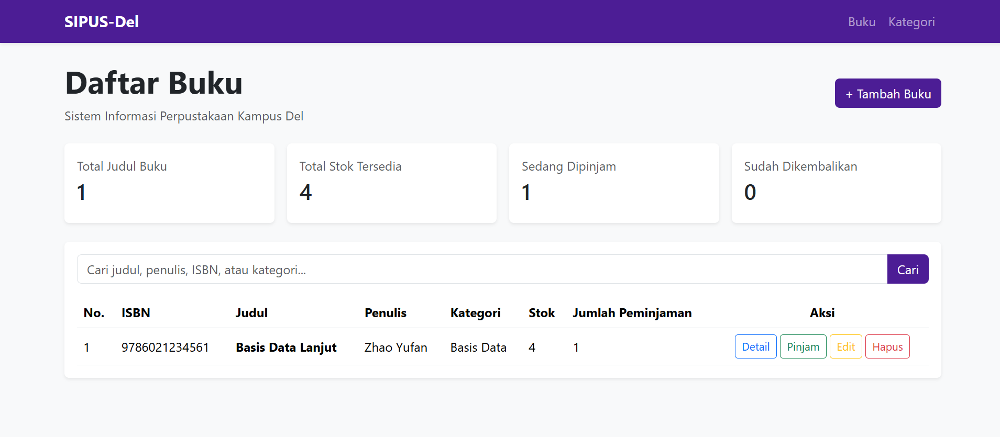
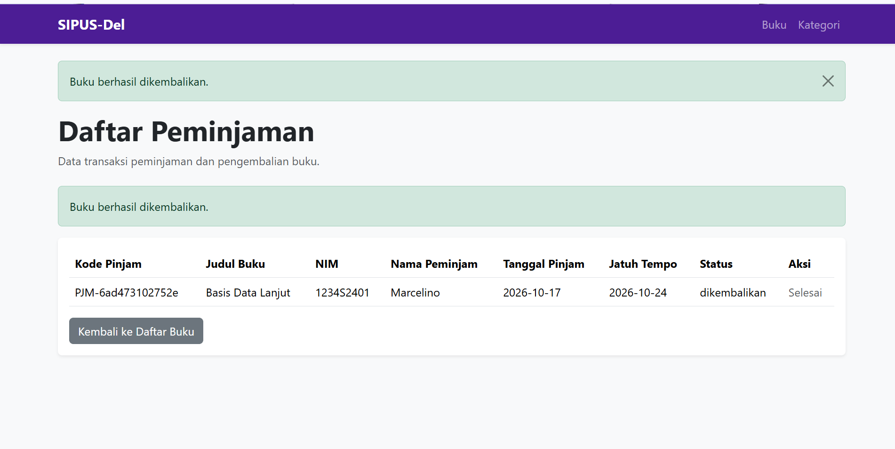
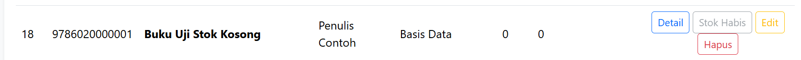
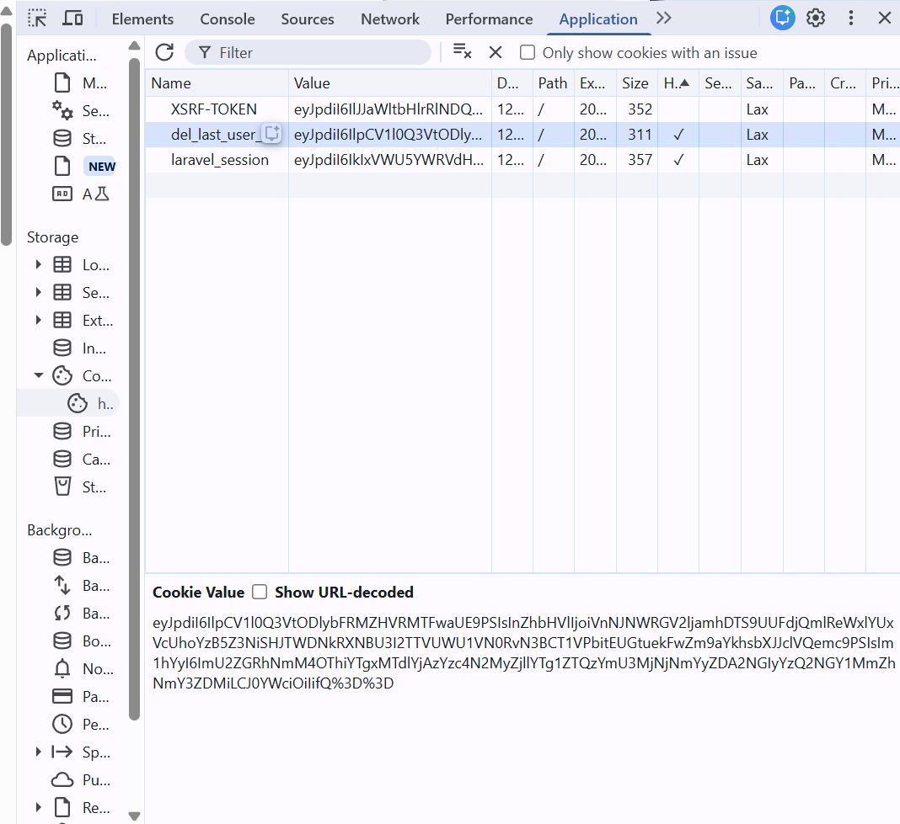

# SIPUS-Del — Sistem Informasi Perpustakaan Kampus Del

SIPUS-Del adalah aplikasi web sederhana untuk membantu pengelolaan data buku, kategori, serta transaksi peminjaman dan pengembalian buku di perpustakaan Kampus Del. Aplikasi ini dibuat menggunakan Laravel dan MySQL sebagai lanjutan praktikum Pemrograman dan Pengujian Web Week 5 dan Week 6.

## Fitur Aplikasi

### Week 5
- Pengelolaan data buku (tambah, lihat, edit, dan hapus).
- Pengelolaan kategori buku.
- Relasi antara buku dan kategori.
- Validasi data pada form.

### Week 6
- Login dan logout pustakawan.
- Proteksi halaman menggunakan middleware `auth`.
- Transaksi peminjaman dan pengembalian buku.
- Pengecekan ketersediaan stok sebelum peminjaman.
- Pembaruan stok setelah peminjaman dan pengembalian.
- Pencatatan transaksi peminjaman.
- Pencarian buku dan statistik perpustakaan.
- Pengelolaan session dan cookie.
- Penggunaan `DB::transaction()` dan `lockForUpdate()` pada transaksi sirkulasi buku.

## Teknologi yang Digunakan

- PHP 8.3
- Laravel 11
- MySQL
- Blade
- Bootstrap 5
- Git dan GitHub

## Persyaratan

Pastikan perangkat sudah memiliki:
- PHP dan ekstensi yang dibutuhkan Laravel.
- Composer.
- MySQL.
- Node.js dan npm jika diperlukan oleh konfigurasi frontend proyek.

## Cara Menjalankan Aplikasi

1. Clone repository dan masuk ke folder proyek.
2. Instal dependensi PHP:

   ```bash
   composer install
   ```

3. Salin `.env.example` menjadi `.env`, kemudian sesuaikan konfigurasi database dengan MySQL lokal.

4. Buat application key:

   ```bash
   php artisan key:generate
   ```

5. Jalankan migrasi yang belum diterapkan:

   ```bash
   php artisan migrate
   ```

6. Jalankan aplikasi:

   ```bash
   php artisan serve
   ```

7. Buka `http://127.0.0.1:8000` melalui browser.

**Catatan:** Database harus sudah dibuat dan konfigurasi `.env` harus sesuai. Jika database Week 5 sudah berisi data, gunakan database tersebut agar data buku dan kategori tetap tersedia. Jangan menjalankan `php artisan migrate:fresh` pada database yang berisi data penting.

## Akun Pengujian

| Keterangan | Nilai |
|---|---|
| Email | `pustakawan@del.ac.id` |
| Password | `password123` |

Akun tersebut disediakan untuk pengujian aplikasi lokal.

## Bukti Pengujian

### 1. Peminjaman Buku

Pengujian peminjaman dilakukan pada buku yang memiliki stok tersedia. Jika peminjaman berhasil, stok buku berkurang satu.



### 2. Pengembalian Buku

Pengujian pengembalian dilakukan pada transaksi yang masih berstatus dipinjam. Setelah pengembalian berhasil, status transaksi berubah menjadi dikembalikan dan stok buku bertambah satu.



### 3. Penolakan Peminjaman Saat Stok Kosong

Buku yang memiliki stok nol tidak tersedia untuk dipinjam melalui katalog.



### 4. Pemeriksaan Cookie HttpOnly

Cookie aplikasi diperiksa melalui Chrome DevTools pada menu Application > Cookies. Cookie `del_last_user_email` dan `laravel_session` dapat diperiksa atribut keamanannya melalui browser.



## Struktur Folder

```text
sipus-del/
├── app/
├── database/
├── resources/
│   └── views/
├── routes/
├── screenshots/
│   ├── peminjaman.png
│   ├── pengembalian.png
│   ├── stok-kosong.png
│   └── cookie-httponly.png
├── tests/
├── .env.example
├── .gitignore
├── composer.json
└── README.md
```

## Catatan Pengembangan

Proyek Week 6 melanjutkan proyek Week 5 dengan mempertahankan data buku dan kategori yang sudah ada. Pengembangan difokuskan pada transaksi peminjaman dan pengembalian, query statistik, autentikasi pustakawan, session, serta cookie.

## Pengumpulan

Repository ini digunakan untuk pengumpulan praktikum Pemrograman dan Pengujian Web Week 6. File `.env` dan folder `vendor/` tidak disertakan dalam repository.
